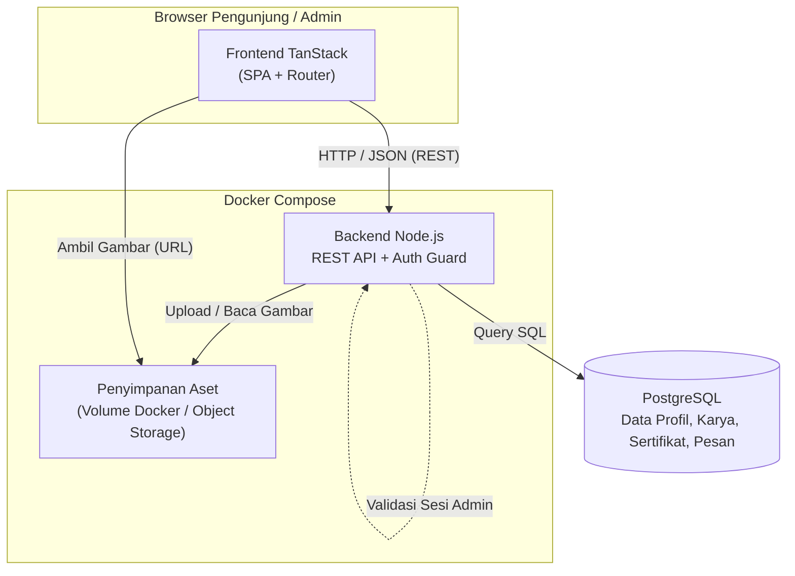
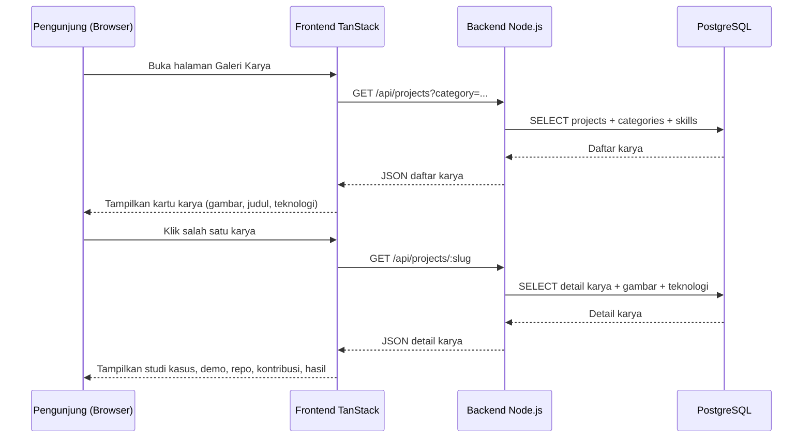
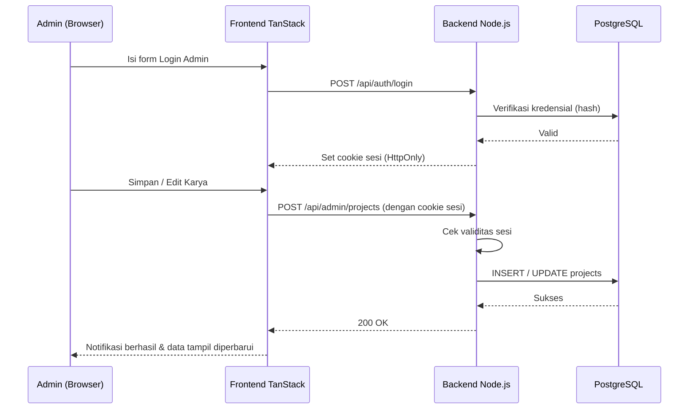
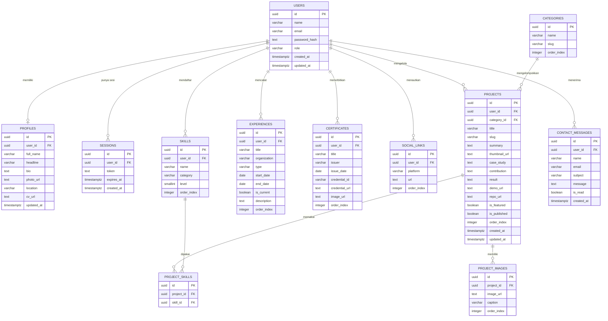

# PRD — Project Requirements Document

## 1. Overview

### Masalah yang Diselesaikan
Mahasiswa tingkat akhir, fresh graduate, dan junior Software Engineer umumnya sudah punya kemampuan teknis, tetapi belum punya cara profesional untuk menunjukkan kualitas hasil kerjanya. Bukti kemampuan mereka tersebar di banyak tempat: repository GitHub, file CV PDF, profil LinkedIn, dan screenshot aplikasi yang dikirim terpisah lewat chat. Informasi penting seperti tujuan proyek, proses pengembangan, teknologi yang dipakai, kontribusi pribadi, dan hasil akhirnya tidak terkumpul dalam satu tempat.

Akibatnya, recruiter atau calon klien harus membuka beberapa tautan sekaligus dan menyusun sendiri gambaran kemampuan pemilik portofolio. Proses ini memakan waktu dan sering membuat kualitas kerja yang sebenarnya bagus jadi kurang terlihat.

### Tujuan Utama
Website portofolio ini menjadi **pusat personal branding profesional** dalam satu tempat, dengan tujuan:

1. **Menyatukan identitas profesional** — profil, keahlian, pengalaman, sertifikat, dan kontak dalam satu website.
2. **Menyajikan karya secara terstruktur** — setiap karya ditampilkan sebagai studi kasus yang menjelaskan masalah, proses, kontribusi, dan hasil, bukan sekadar screenshot.
3. **Mempermudah penilaian** — recruiter atau calon klien bisa memahami kemampuan dan cara berpikir pemilik portofolio tanpa berpindah-pindah sumber.
4. **Memberi kesan rapi dan kredibel** — tampilan bersih, konsisten, dan nyaman dibaca di desktop maupun ponsel.
5. **Mudah diperbarui** — pemilik bisa menambah atau mengubah karya sendiri lewat panel admin, sehingga website tetap hidup dan relevan.

### First Win (Kemenangan Pertama Pengguna)
Pengunjung yang baru membuka website **langsung melihat daftar karya** dalam satu halaman galeri yang rapi. Dalam hitungan detik, mereka sudah mendapat gambaran tentang apa yang pernah dibuat, teknologi yang dipakai, dan tingkat kemampuan pemilik portofolio.

### Nilai Pembeda
- **Lebih rapi** dibandingkan menyebar tautan di CV atau LinkedIn.
- **Karya baru** menjadi alasan pengunjung untuk kembali lagi (konten yang terus diperbarui melalui panel admin).

---

## 2. Requirements

### Functional Requirements
| Kode | Persyaratan |
|---|---|
| FR-01 | Pengunjung dapat melihat halaman profil berisi tentang saya, keahlian, pengalaman, dan tautan unduh CV. |
| FR-02 | Pengunjung dapat melihat galeri karya dengan gambar, judul, ringkasan, dan teknologi utama. |
| FR-03 | Pengunjung dapat menyaring karya berdasarkan kategori/teknologi. |
| FR-04 | Pengunjung dapat membuka detail karya berisi studi kasus, tautan demo, tautan repo, kontribusi, teknologi, dan hasil akhir. |
| FR-05 | Pengunjung dapat melihat daftar dan detail sertifikat beserta penerbit dan tanggal. |
| FR-06 | Pengunjung dapat mengirim pesan lewat form kontak dan menerima konfirmasi terkirim. |
| FR-07 | Pemilik dapat login/logout sebagai admin dengan sesi yang aman. |
| FR-08 | Admin dapat menambah, mengedit, menghapus, dan mengatur karya yang ditonjolkan. |
| FR-09 | Seluruh halaman dapat digunakan dengan nyaman di layar ponsel. |
| FR-10 | Data konten (profil, karya, sertifikat, keahlian) tersimpan permanen di database dan dapat diperbarui tanpa mengubah kode. |

### Non-Functional Requirements
| Kode | Persyaratan |
|---|---|
| NFR-01 | **Responsif / Mobile-first** — layout diuji di desktop dan ponsel; tidak ada elemen terpotong atau horizontal scroll. |
| NFR-02 | **Performa** — halaman galeri tampil cepat (target waktu muat awal < 3 detik pada koneksi normal), gambar dioptimalkan. |
| NFR-03 | **SEO dasar** — judul halaman, meta description, dan URL karya yang mudah dibaca (slug). |
| NFR-04 | **Keamanan** — halaman admin hanya bisa diakses setelah login; password disimpan dalam bentuk hash; form kontak terlindungi dari spam dasar. |
| NFR-05 | **Kemudahan pakai** — navigasi jelas, teks mudah dibaca, kontras memadai. |
| NFR-06 | **Keterbacaan konten** — struktur studi kasus konsisten di setiap karya. |
| NFR-07 | **Portabilitas** — aplikasi berjalan lewat container Docker sehingga mudah dipindahkan antar server. |
| NFR-08 | **Ketersediaan** — website dapat diakses publik 24/7 dengan uptime wajar. |

### Batasan (Constraints)
- Tech stack dikunci: **TanStack (frontend), Node.js (backend), PostgreSQL (database), Docker (deployment)**. Tidak ada penggantian atau rekomendasi alternatif.
- Proyek dibangun di atas template **Starter Tanstack v0.1.0** sehingga setup awal sudah tersedia.
- Tidak ada fitur tambahan di luar roadmap yang disetujui.
- Tidak ada integrasi pembayaran, multi-bahasa, atau sistem komentar pada versi ini.

---

## 3. Core Features

### Fase 1 — Galeri Karya `[high]`
Menampilkan semua karya dalam satu daftar rapi agar pengunjung langsung melihat hasil kerja terbaik.
- **Daftar Karya** — Menampilkan kartu karya dengan gambar, judul, dan teknologi utama.
- **Filter Kategori** — Memudahkan pengunjung menyaring karya berdasarkan jenis atau teknologi.
- **Karya Terbaru** — Menonjolkan karya paling baru agar pengunjung tahu ada pembaruan.
- **Ringkasan Kartu** — Memberi gambaran singkat tiap karya sebelum dibuka lebih detail.

### Fase 2 — Detail Karya `[high]`
Membuka satu karya secara lengkap agar pengunjung memahami proses dan hasilnya.
- **Studi Kasus** — Menjelaskan tujuan, masalah, dan proses pengembangan karya.
- **Demo & Repo** — Menyediakan tautan demo aplikasi dan repository GitHub karya.
- **Kontribusi Saya** — Menunjukkan bagian pekerjaan yang dikerjakan sendiri oleh pemilik karya.
- **Teknologi Dipakai** — Menampilkan teknologi dan alat yang digunakan dalam proyek.
- **Hasil Akhir** — Memperlihatkan hasil atau dampak dari karya yang sudah dibuat.

### Fase 2 — Profil & Keahlian `[high]`
Menyatukan informasi tentang pemilik, keahlian, dan pengalaman dalam satu halaman.
- **Tentang Saya** — Memperkenalkan diri, minat, dan fokus karier pemilik portofolio.
- **Daftar Keahlian** — Menampilkan kemampuan teknis yang dikuasai secara ringkas.
- **Pengalaman** — Menampilkan riwayat pekerjaan, organisasi, atau kegiatan relevan.
- **Unduh CV** — Memudahkan pengunjung mengunduh CV dalam bentuk PDF.

### Fase 2 — Sertifikat `[medium]`
Menampilkan sertifikat dan pencapaian sebagai bukti tambahan kemampuan.
- **Daftar Sertifikat** — Menampilkan semua sertifikat dalam susunan yang mudah dilihat.
- **Detail Sertifikat** — Membuka informasi lengkap satu sertifikat beserta gambarnya.
- **Penerbit & Tanggal** — Menunjukkan lembaga penerbit dan waktu sertifikat diperoleh.

### Fase 3 — Form Kontak `[high]`
Memudahkan pengunjung menghubungi pemilik portofolio secara profesional.
- **Kirim Pesan** — Menyediakan formulir untuk mengirim pesan langsung dari website.
- **Info Kontak** — Menampilkan email, media sosial, dan tautan profesional lainnya.
- **Konfirmasi Terkirim** — Memberi tanda bahwa pesan berhasil dikirim agar pengunjung tenang.

### Fase 4 — Masuk Admin `[medium]`
Membatasi pengelolaan konten hanya untuk pemilik portofolio.
- **Login Admin** — Memungkinkan pemilik masuk untuk mengelola isi portofolio.
- **Logout Aman** — Mengakhiri sesi admin dengan aman setelah selesai mengelola.
- **Kelola Sesi** — Menjaga akses admin tetap terlindungi saat berpindah perangkat.

### Fase 4 — Kelola Karya `[high]`
Memungkinkan pemilik menambah dan memperbarui karya agar pengunjung kembali lagi.
- **Tambah Karya** — Menambahkan karya baru lengkap dengan gambar dan informasi utama.
- **Edit Karya** — Memperbarui isi atau tampilan karya yang sudah ada.
- **Hapus Karya** — Menghapus karya yang sudah tidak ingin ditampilkan.
- **Atur Tampil** — Mengatur karya mana yang ditonjolkan di halaman galeri.

### Fase 5 — Tampilan HP Rapi `[medium]`
Membuat seluruh halaman tetap nyaman dibaca dan digunakan di layar ponsel.
- **Layout Menyesuaikan** — Menyusun ulang isi halaman agar pas di layar kecil.
- **Menu Mobile** — Menyediakan menu yang mudah dijangkau saat dibuka di ponsel.
- **Galeri di HP** — Menampilkan daftar karya tetap rapi dan mudah digeser di ponsel.

---

## 4. User Flow

### A. Pengunjung (Recruiter / Calon Klien)
1. **Masuk ke halaman utama** — langsung disambut ringkasan profil singkat dan galeri karya terbaru (Fase 1).
2. **Melihat galeri karya** — kartu karya tampil rapi dengan gambar, judul, ringkasan singkat, dan teknologi utama.
3. **Menyaring karya** — memilih kategori atau teknologi tertentu untuk mempersempit daftar (Fase 1).
4. **Membuka detail karya** — membaca studi kasus: tujuan, masalah, proses, kontribusi pribadi, teknologi, dan hasil akhir; dapat membuka tautan demo atau repository (Fase 2).
5. **Membuka halaman profil** — membaca tentang saya, daftar keahlian, dan riwayat pengalaman; mengunduh CV PDF bila diperlukan (Fase 2).
6. **Melihat sertifikat** — membuka daftar sertifikat dan detailnya, termasuk penerbit dan tanggal (Fase 2).
7. **Menghubungi pemilik** — mengisi form kontak atau memakai info kontak yang tersedia, lalu menerima konfirmasi pesan terkirim (Fase 3).
8. **Membuka website di ponsel** — seluruh halaman tetap rapi, menu mudah dijangkau, galeri nyaman digeser (Fase 5).

### B. Pemilik Portofolio (Admin)
1. **Login admin** — masuk menggunakan kredensial yang valid; sesi tersimpan dengan aman (Fase 4).
2. **Membuka dashboard** — melihat daftar karya yang sudah tayang.
3. **Menambah karya baru** — mengisi judul, ringkasan, gambar, kategori, teknologi, studi kasus, kontribusi, tautan demo/repo, dan hasil akhir (Fase 4).
4. **Mengedit atau menghapus karya** — memperbarui konten lama atau menghapus karya yang tak lagi ditampilkan (Fase 4).
5. **Mengatur tampilan** — menandai karya yang ingin ditonjolkan di galeri dan mengurutkannya (Fase 4).
6. **Memeriksa pesan masuk** — membaca pesan dari form kontak.
7. **Logout** — mengakhiri sesi dengan aman (Fase 4).

### Alur Singkat (Ringkasan)
```
Pengunjung → Galeri Karya → Filter → Detail Karya → Profil/Keahlian → Sertifikat → Form Kontak → Konfirmasi
Admin → Login → Dashboard → Tambah/Edit/Hapus Karya → Atur Tampil → Logout
```

---

## 5. Architecture

### Gambaran Umum
Aplikasi memakai pola **client–server terpisah**: frontend TanStack berjalan di browser sebagai single-page application, memanggil **REST API** dari server Node.js, yang membaca dan menulis data ke **PostgreSQL**. Seluruh komponen dijalankan lewat **Docker Compose** agar konsisten di lokal maupun server produksi.

- **Halaman publik** — galeri karya, detail karya, profil, sertifikat, kontak. Dapat diakses tanpa login.
- **Halaman admin** — login, dashboard, kelola karya. Dilindungi oleh sesi autentikasi; API memverifikasi sesi sebelum memproses permintaan tulis.
- **Penyimpanan gambar** — file gambar (foto profil, thumbnail karya, gambar sertifikat) disimpan pada volume/objek storage dan dirujuk lewat URL di database.

### Diagram Arsitektur (Flow)


### Diagram Sekuens — Pengunjung Melihat Karya


### Diagram Sekuens — Admin Mengelola Karya


### Catatan Implementasi
- Rute publik dan rute admin dipisahkan pada frontend; rute admin melakukan pemeriksaan sesi sebelum merender halaman.
- Endpoint tulis (`POST`, `PUT`, `DELETE`) selalu memverifikasi sesi di sisi server — bukan hanya menyembunyikan tombol di UI.
- Gambar diunggah lewat endpoint khusus lalu disimpan ke volume/storage; database hanya menyimpan URL-nya.
- Konfigurasi sensitif (koneksi database, secret sesi) disediakan lewat environment variable di Docker Compose.

---

## 6. Database Schema

Semua tabel menggunakan `id` bertipe `uuid` sebagai primary key dan `created_at` / `updated_at` bertipe `timestamptz` untuk jejak waktu.

### Tabel `users`
Menyimpan akun pemilik portofolio (admin).
| Field | Tipe | Kegunaan |
|---|---|---|
| id | uuid (PK) | Identitas unik pengguna |
| name | varchar(120) | Nama tampilan admin |
| email | varchar(255), unique | Email untuk login |
| password_hash | text | Password ter-hash (tidak pernah disimpan mentah) |
| role | varchar(20) | Peran akses, default `admin` |
| created_at | timestamptz | Waktu akun dibuat |
| updated_at | timestamptz | Waktu terakhir diubah |

### Tabel `sessions`
Menyimpan sesi login aktif agar admin tetap masuk dengan aman.
| Field | Tipe | Kegunaan |
|---|---|---|
| id | uuid (PK) | Identitas sesi |
| user_id | uuid (FK → users.id) | Pemilik sesi |
| token | text, unique | Token sesi (cookie HttpOnly) |
| expires_at | timestamptz | Batas waktu berlaku sesi |
| created_at | timestamptz | Waktu sesi dibuat |

### Tabel `profiles`
Data profil utama untuk halaman "Tentang Saya".
| Field | Tipe | Kegunaan |
|---|---|---|
| id | uuid (PK) | Identitas profil |
| user_id | uuid (FK → users.id), unique | Profil milik satu akun |
| full_name | varchar(120) | Nama lengkap |
| headline | varchar(160) | Judul profesional singkat (mis. "Junior Frontend Engineer") |
| bio | text | Penjelasan tentang diri, minat, dan fokus karier |
| photo_url | text | URL foto profil |
| location | varchar(120) | Domisili |
| cv_url | text | URL file CV PDF untuk diunduh |
| updated_at | timestamptz | Waktu terakhir diperbarui |

### Tabel `skills`
Daftar keahlian teknis yang ditampilkan di halaman profil.
| Field | Tipe | Kegunaan |
|---|---|---|
| id | uuid (PK) | Identitas keahlian |
| user_id | uuid (FK → users.id) | Pemilik keahlian |
| name | varchar(80) | Nama keahlian (mis. "React", "PostgreSQL") |
| category | varchar(60) | Kelompok keahlian (frontend/backend/tools) |
| level | smallint | Tingkat penguasaan (1–5) untuk tampilan indikator |
| order_index | integer | Urutan tampil |

### Tabel `experiences`
Riwayat pengalaman kerja, organisasi, atau kegiatan relevan.
| Field | Tipe | Kegunaan |
|---|---|---|
| id | uuid (PK) | Identitas pengalaman |
| user_id | uuid (FK → users.id) | Pemilik riwayat |
| title | varchar(120) | Posisi atau peran |
| organization | varchar(120) | Nama perusahaan/organisasi |
| type | varchar(30) | Jenis: `work`, `organization`, `freelance`, `education` |
| start_date | date | Tanggal mulai |
| end_date | date, nullable | Tanggal selesai (kosong bila masih berjalan) |
| is_current | boolean | Penanda masih aktif |
| description | text | Ringkasan pekerjaan/kegiatan |
| order_index | integer | Urutan tampil |

### Tabel `categories`
Kategori karya untuk kebutuhan filter di galeri.
| Field | Tipe | Kegunaan |
|---|---|---|
| id | uuid (PK) | Identitas kategori |
| name | varchar(60), unique | Nama kategori (mis. "Web App", "Mobile") |
| slug | varchar(80), unique | Versi URL-friendly untuk filter |
| order_index | integer | Urutan tampil |

### Tabel `projects`
Data utama karya; menjadi inti galeri dan halaman detail.
| Field | Tipe | Kegunaan |
|---|---|---|
| id | uuid (PK) | Identitas karya |
| user_id | uuid (FK → users.id) | Pemilik karya |
| category_id | uuid (FK → categories.id) | Kategori karya untuk filter |
| title | varchar(160) | Judul karya |
| slug | varchar(180), unique | URL halaman detail karya |
| summary | text | Ringkasan singkat untuk kartu galeri |
| thumbnail_url | text | Gambar utama kartu karya |
| case_study | text | Uraian studi kasus: tujuan, masalah, proses |
| contribution | text | Bagian pekerjaan yang dikerjakan sendiri |
| result | text | Hasil akhir atau dampak karya |
| demo_url | text, nullable | Tautan demo aplikasi |
| repo_url | text, nullable | Tautan repository GitHub |
| is_featured | boolean | Penanda karya ditonjolkan di galeri |
| is_published | boolean | Penanda karya tayang atau masih draf |
| order_index | integer | Urutan tampil di galeri |
| created_at | timestamptz | Waktu dibuat (dasar urutan "Karya Terbaru") |
| updated_at | timestamptz | Waktu terakhir diubah |

### Tabel `project_images`
Gambar tambahan pada halaman detail karya.
| Field | Tipe | Kegunaan |
|---|---|---|
| id | uuid (PK) | Identitas gambar |
| project_id | uuid (FK → projects.id) | Karya pemilik gambar |
| image_url | text | URL gambar |
| caption | varchar(200), nullable | Keterangan gambar |
| order_index | integer | Urutan tampil |

### Tabel `project_skills`
Relasi teknologi yang dipakai pada setiap karya (many-to-many).
| Field | Tipe | Kegunaan |
|---|---|---|
| id | uuid (PK) | Identitas relasi |
| project_id | uuid (FK → projects.id) | Karya terkait |
| skill_id | uuid (FK → skills.id) | Teknologi/alat yang dipakai |

### Tabel `certificates`
Sertifikat dan pencapaian sebagai bukti tambahan kemampuan.
| Field | Tipe | Kegunaan |
|---|---|---|
| id | uuid (PK) | Identitas sertifikat |
| user_id | uuid (FK → users.id) | Pemilik sertifikat |
| title | varchar(160) | Nama sertifikat |
| issuer | varchar(120) | Lembaga penerbit |
| issue_date | date | Tanggal sertifikat diperoleh |
| credential_id | varchar(120), nullable | Nomor/ID kredensial |
| credential_url | text, nullable | Tautan verifikasi sertifikat |
| image_url | text, nullable | Gambar sertifikat |
| order_index | integer | Urutan tampil |

### Tabel `social_links`
Info kontak dan tautan profesional yang ditampilkan di halaman kontak.
| Field | Tipe | Kegunaan |
|---|---|---|
| id | uuid (PK) | Identitas tautan |
| user_id | uuid (FK → users.id) | Pemilik tautan |
| platform | varchar(60) | Nama platform (GitHub, LinkedIn, Email, dll.) |
| url | text | Alamat tautan atau alamat email |
| order_index | integer | Urutan tampil |

### Tabel `contact_messages`
Pesan yang dikirim pengunjung melalui form kontak.
| Field | Tipe | Kegunaan |
|---|---|---|
| id | uuid (PK) | Identitas pesan |
| user_id | uuid (FK → users.id, nullable) | Admin tujuan pesan |
| name | varchar(120) | Nama pengirim |
| email | varchar(255) | Email pengirim untuk balasan |
| subject | varchar(160), nullable | Subjek pesan |
| message | text | Isi pesan |
| is_read | boolean | Status sudah dibaca atau belum |
| created_at | timestamptz | Waktu pesan dikirim |

### Diagram Relasi (ER)


---

## 7. Tech Stack

### Fondasi Proyek
Proyek ini dibangun di atas template **Starter Tanstack v0.1.0 (NgodingPakeAI)** — codebase siap pakai dengan stack **TanStack (frontend), Node.js (backend), PostgreSQL (database), dan Docker (deployment)**. Setup awal berupa kerangka framework, koneksi database, mekanisme autentikasi, serta konfigurasi container **sudah tersedia**. Artinya, pekerjaan implementasi tidak dimulai dari nol: tim langsung menambahkan fitur-fitur pada roadmap di atas fondasi yang ada.

### Rincian Stack
| Lapisan | Teknologi | Peran |
|---|---|---|
| Frontend | **TanStack** (TanStack Router / TanStack Query) | Routing halaman publik & admin, pengambilan data dari API, tampilan antarmuka responsif. |
| Styling | Utility CSS berbasis komponen | Menjaga tampilan rapi, konsisten, dan mobile-first (mendukung Fase 5). |
| Backend | **Node.js** | Menyediakan REST API: karya, profil, keahlian, pengalaman, sertifikat, kontak, dan endpoint admin. |
| Database | **PostgreSQL** | Menyimpan seluruh data konten relasional sesuai skema di bagian 6. |
| Autentikasi | Mekanisme auth bawaan template | Login, logout, dan pengelolaan sesi admin (Fase 4). |
| Deployment | **Docker** (+ Docker Compose) | Menjalankan frontend, backend, dan PostgreSQL dalam container yang konsisten di lokal maupun produksi. |

### Catatan Teknis
- **Tidak ada perubahan stack.** Semua fitur dirancang agar berjalan di atas kombinasi di atas tanpa teknologi tambahan di luar ekosistem tersebut.
- **Pemisahan tanggung jawab** — frontend hanya menampilkan dan memanggil API; seluruh validasi data dan pemeriksaan sesi dilakukan di backend.
- **Manajemen aset gambar** — file gambar disimpan pada volume Docker atau object storage, sementara database hanya menyimpan URL-nya agar query tetap ringan.
- **Konfigurasi** — kredensial database dan secret sesi dikelola lewat environment variable pada Docker Compose, tidak ditulis di dalam kode.
- **Alur kerja pengembangan** — fitur dikerjakan berurutan sesuai fase roadmap: Fase 1 (Galeri Karya) → Fase 2 (Detail Karya, Profil & Keahlian, Sertifikat) → Fase 3 (Form Kontak) → Fase 4 (Masuk Admin, Kelola Karya) → Fase 5 (Tampilan HP Rapi), dengan pengujian responsif di desktop dan ponsel pada setiap fase.